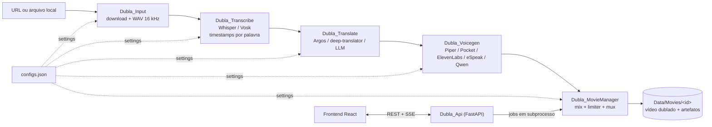
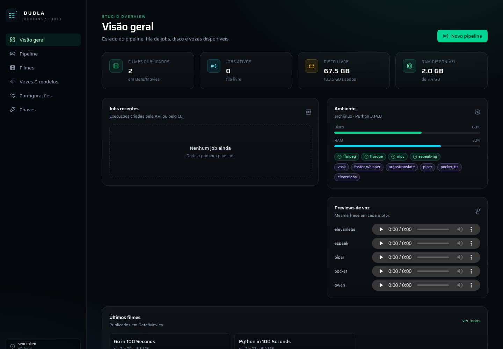

<p align="center">
  
</p>

<h1 align="center">Dubla</h1>

<p align="center">
  Pipeline de dublagem automática: baixa o vídeo, transcreve, traduz, gera as vozes e publica o filme dublado.
</p>

---

## O que faz

Dubla recebe **uma URL** (YouTube) ou um arquivo local e entrega um **MP4 dublado** com áudio sincronizado:

1. **Baixa** e separa o áudio em WAV 16 kHz mono, deixando o vídeo mudo.
2. **Transcreve** com timestamps por palavra (faster-whisper ou Vosk).
3. **Traduz** cada bloco de fala (Argos offline, deep-translator ou qualquer LLM OpenAI-compatible).
4. **Gera voz** por bloco (Piper, Pocket TTS, Qwen3-TTS, ElevenLabs ou eSpeak NG).
5. **Monta a trilha**, ajusta cada fala ao tempo original (até 1,35×) e faz o mux.
6. **Publica** em `Data/Movies/<id>/` com o histórico completo em JSON.

## Diagrama



## Stack

| Camada | Tecnologia |
| --- | --- |
| Entrada | yt-dlp, ffmpeg |
| STT | faster-whisper (`base` por padrão), Vosk |
| Tradução | Argos (offline), deep-translator, LLM via SDK OpenAI |
| Voz | Piper, Pocket TTS, Qwen3-TTS, ElevenLabs, eSpeak NG |
| Mux | ffmpeg (vídeo copiado, AAC 48 kHz estéreo) |
| API | FastAPI + jobs em subprocesso + SSE |
| Frontend | React 19, Vite, TypeScript, Tailwind v4 |

## Interface



## Começando

```bash
git clone git@github.com:marcosgabrielgomes110-collab/Dubla.git
cd Dubla

make install       # dependências Python + npm
make up            # API :8000 + Vite :5173
make logs          # acompanha os logs
make stop          # encerra os dois
```

Produção local (a API serve o build em `http://127.0.0.1:8000`):

```bash
make up-prod
```

Pipeline direto pelo terminal, sem frontend:

```bash
python -m src.Dubla_MovieManager "https://www.youtube.com/watch?v=..."
```

Pré-requisitos de sistema: `ffmpeg`, `mpv` e, para a voz robótica, `espeak-ng`
(`sudo pacman -S ffmpeg mpv espeak-ng`).

## Saída

```
Data/Movies/<id>/
├── <titulo>_Dubla_pt-BR.mp4   # filme dublado
├── <id>_original_mudo.mp4
├── <id>.wav
├── <id>.json                  # stt, segments_traduct, voice, movie
└── voice/                     # um WAV por bloco
```

## Documentação

- [`docs/SYSTEM.md`](docs/SYSTEM.md) — arquitetura, módulos, dados e configuração
- [`docs/API.md`](docs/API.md) — referência HTTP (jobs, SSE, settings, filmes)
- [`frontend/README.md`](frontend/README.md) — telas, dev e build
- Docs por módulo em `src/Dubla_Input`, `Dubla_Transcribe`, `Dubla_Translate`,
  `Dubla_Voicegen`, `Dubla_MovieManager` e `Dubla_Api`

## Testes

```bash
make test     # pytest (28 testes)
make all      # install + build + test
```

Cobrem API (settings, jobs, filmes, streaming, auth), mux, publicação, merge de segmentos,
ajuste de duração e logging JSON.

## Licença

[MIT](LICENSE) © 2026 Dubla contributors.

Contribuições: veja [CONTRIBUTING.md](CONTRIBUTING.md) e a
[política de segurança](SECURITY.md).
